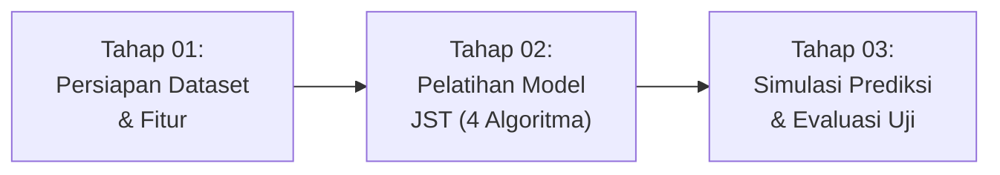

# 📖 Panduan Singkat Penggunaan: Virtual Lab JST Mahasiswa

> **Virtual Lab Jaringan Saraf Tiruan (JST) — Supervised Learning**  
> Didesain dengan gaya **Academic Workbench & Minimalist Swiss (`ui-ux-pro-max`)**, ramah pengguna, bebas *AI-slop*, serta mendukung **Dark Mode** & **Responsif (Mobile / Tablet / Laptop)**.

---

## 📂 1. Berkas di Dalam Folder Ini

| Nama Berkas | Fungsi & Keterangan |
| :--- | :--- |
| **`index.html`** / **`virtual_lab_jst_mahasiswa.html`** | Aplikasi web utama Virtual Lab (*single-page app*). Bisa langsung dibuka di browser tanpa perlu install server (*zero-dependency*). |
| **`dataset_mahasiswa.csv`** | Dataset akademik 221 baris rekam studi mahasiswa (NIM, tahun masuk/lulus, IPS 1-4, IPK, status kerja, keterangan kelulusan). |
| **`README.md`** | Dokumentasi teknis & akademis lengkap (latar belakang, rumus matematis 4 algoritma, dan tabel hasil evaluasi). |
| **`push-standalone-repo.ps1`** | Skrip otomatis PowerShell untuk mempublikasikan lab ke repositori GitHub mandiri & mengaktifkan GitHub Pages. |
| **`PANDUAN_SINGKAT.md`** | Berkas panduan operasional praktis ini. |

---

## 🚀 2. Cara Menjalankan Aplikasi

1. **Secara Lokal (Offline / Tanpa Internet):**
   * Cukup **klik ganda (double-click)** pada berkas `index.html` atau `virtual_lab_jst_mahasiswa.html`.
   * Aplikasi akan langsung terbuka di Google Chrome, Edge, Firefox, atau browser default Anda.
2. **Secara Online (GitHub Pages):**
   * Demo publik dapat diakses di: **[https://nailulgh.github.io/virtual-lab-jst-mahasiswa/](https://nailulgh.github.io/virtual-lab-jst-mahasiswa/)**

---

## 🧭 3. Alur 3 Tahap Menggunakan Virtual Lab

Aplikasi dibagi menjadi 3 tahapan terstruktur yang dapat diakses melalui bilah navigasi atas (*stepper*):



### 🔹 Tahap 01: Persiapan Dataset & Fitur
1. **Pilih Skenario Bawaan atau Upload:**
   * **Skenario A (Rekomendasi):** *Ketepatan Waktu Kelulusan* (`keterangan`: tepat vs tidak tepat).
   * **Skenario B:** *Predikat Yudisium* (`predikat_yudisium`: sangat memuaskan vs memuaskan).
   * **Skenario C:** *Status Bekerja* (`status_bekerja`: bekerja vs mahasiswa).
   * **Upload CSV:** Anda juga bisa mengunggah file CSV lain dari komputer Anda melalui tombol **"Upload File CSV"**.
2. **Pilih Fitur ($X$) & Target ($t$):**
   * Centang kolom yang ingin dijadikan fitur input (misal: `tahun_masuk`, `tahun_yudisium`, `ips1`–`ips4`).
   * Pilih kolom target dan label positifnya.
3. **Pemeriksaan Data:**
   * Lihat tabel di sebelah kanan. Anda dapat mengaktifkan sakelar **`[0-1]`** untuk melihat data yang sudah dinormalisasi Min-Max atau melihat nilai aslinya.
   * Data secara otomatis dibagi menjadi **80% Data Latih** dan **20% Data Uji**.

---

### 🔹 Tahap 02: Pengaturan & Proses Pelatihan JST
1. **Pilih Algoritma JST:**
   * **Perceptron Learning Rule:** Pilihan terbaik untuk klasifikasi linear biner (mencapai akurasi 100% pada skenario kelulusan).
   * **Backpropagation (MLP 4-3-1):** Jaringan saraf multilapis dengan aktivasi sigmoid kontinu untuk pemisahan data non-linear.
   * **Delta Rule (LMS / Widrow-Hoff):** Menggunakan kuadrat error minimum secara kontinu.
   * **Hebb Rule:** Pembelajaran asosiatif berbasis representasi bipolar $\{-1, +1\}$.
2. **Atur Parameter:**
   * Tentukan *Learning Rate* ($\alpha$), *Threshold* ($\theta$), dan *Max Epoch* (default sudah disesuaikan secara optimal).
3. **Mulai Pelatihan:**
   * Klik **+1 Sampel** untuk melihat per langkah data masuk dan bagaimana rumus menghitung bobot baru.
   * Klik **+1 Epoch** untuk menjalankan 1 putaran penuh data latih.
   * Klik **Auto-Run** untuk melatih dengan animasi progresif per epoch.
   * Klik **Latih Selesai** untuk langsung menyelesaikan pelatihan hingga konvergen / batas epoch tercapai secara instan.
4. **Amati Visualisasi:**
   * **Kanvas Arsitektur JST:** Garis sinapsis menebal/menipis dan berubah warna sesuai besaran bobot $w_i$.
   * **Grafik Konvergensi MSE:** Mengamati kurva penurunan *Mean Squared Error* per epoch secara real-time.
   * **Inspeksi Matematis:** Membaca kalkulasi eksplisit $y_{in} = b + \sum x_i w_i$, error $e = t - \hat{y}$, dan penyesuaian bobot $\Delta w_i$.

---

### 🔹 Tahap 03: Pengujian Langsung & Evaluasi Model
1. **Simulasi Prediksi Langsung (Panel Kiri):**
   * Masukkan nilai fitur mahasiswa secara manual, atau klik tombol **"Contoh Kelas 1 (Lulus)"** / **"Contoh Kelas 0 (Tidak)"** untuk mengisi angka secara otomatis.
   * Klik **"Hitung Prediksi Sekarang"** untuk melihat hasil output jaringan saraf tiruan beserta nilai normalisasi dan nilai fungsi aktivasi ($y_{in}$).
2. **Evaluasi Data Uji (Panel Kanan):**
   * Lihat tabel **Evaluasi Ketepatan Model pada Data Uji (20%)**.
   * Gunakan tombol filter: **Semua**, **Lulus 1**, **Tidak 0**, atau **Meleset** untuk menyaring baris tertentu.
   * **Klik baris mana saja pada tabel** untuk langsung menguji data mahasiswa tersebut ke dalam simulator di sebelah kiri.
   * Periksa persentase **Akurasi Akhir (%)** dan tabel **Confusion Matrix** (*True Positive, True Negative, False Positive, False Negative*).

---

## 💡 4. Fitur Tambahan & Kenyamanan Visual

* **Dark Mode & Light Mode:**
  * Klik ikon matahari/bulan (☀️ / 🌙) di pojok kanan atas header untuk berganti tema.
  * Tema gelap menggunakan palet *Carbon Slate* matte anti-silau yang ramah mata.
* **Mode Tampilan (Semua Tahap vs Mode Fokus):**
  * Klik tombol **"Mode Semua Tahap"** untuk berganti ke **"Mode Fokus"** jika Anda hanya ingin melihat satu tahap pada satu waktu tanpa gangguan.
* **Panduan Rumus Matematis:**
  * Klik tombol **"Panduan Rumus"** pada header untuk membuka modal referensi rumus lengkap (Perceptron, Delta Rule, Sigmoid Backprop, dan Hebb) berformat LaTeX.

---

## 🌐 5. Opsi Push ke Repositori Mandiri GitHub Pages

Jika Anda ingin mengunggah lab ini ke repositori publik terpisah:
1. Buat repositori kosong baru di web [github.com/new](https://github.com/new) bernama: **`virtual-lab-jst-mahasiswa`**.
2. Jalankan PowerShell di folder ini:
   ```powershell
   .\push-standalone-repo.ps1
   ```
3. Buka repositori di GitHub $\rightarrow$ masuk ke menu **Settings** $\rightarrow$ **Pages** $\rightarrow$ pilih branch **main** dan folder **/(root)** $\rightarrow$ klik **Save**.
4. Aplikasi Anda akan langsung memiliki link live demo online yang dapat dikirimkan ke dosen atau teman.
